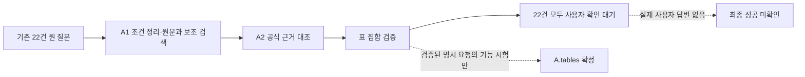

> 이전 A(10-06, A1/A2) 문서다. 현재 A는 N5이며 설명은 claview-A-1015의 docs를 본다.

# A1/A2 개선 6단계: 기존 22건 통합 평가

기준일: 2026-10-06. **후보 탐색은 유지됐지만 일반 자연어의 최종 자동 확정은 아직 작동 범위에 들어오지 않았다.** 현재 상태는 사용자가 후보를 보고 확정하는 A로 설명해야 한다. 7·8단계는 진행하지 않았다.

- 실행·보존 검증: `worked`. 동일 코드·자료로 6개 설정을 실행하고 원 질문·이전 기록을 보존했다.
- 검색 품질 개선: `inconclusive`. 정답 포함과 순위는 개선 전과 같다.
- 일반 질문 자동 확정 목표: 이번 22건에서는 달성하지 못했다. 자동 채택 0건이며 정확도는 해당 없음이다.
- 모델 효과: `inconclusive`. 5단계의 HCX 응답 7건은 모두 원문 위치 검증 실패였으며, 이번에는 모델 off를 선택했다.

## 범위와 실행 경로



원 질문을 실행기에 전달하고, 정답은 실행 결과에 대한 사후 평가에서만 사용했다. 정답 표나 정답 개수를 사용자 답변처럼 넣지 않았다. 기존 22건은 모두 단일 표 정답이며, 임의 추가 48건과 기능 시험은 지표에 합산하지 않았다.

5단계에서 채택한 모델 구성은 **off**다. 실제 적용에 성공한 해석이 없었으므로 같은 계약의 실패를 22건 추가 호출로 반복하지 않았다. 사용자가 허용한 최대44회·질문당2회는 상한이며 의무 호출 수가 아니다. 실행 전 계획에 요청·입력/출력 토큰 예약·출력 상한을 모두0으로 기록하고 네트워크를 차단했다. 새 모델 비교·프롬프트 수정·실제 통계 API·B 실행은 없다. **22건 모델 live 검증을 완료했다고 표시하지 않는다.**

## 실제 변경과 재사용

운영 코드 `src/claview/`는 수정하지 않았다. 검색·자동 채택 규칙·사전·골든셋·모델 계약과 기본값도 유지했다.

- 추가: [evaluate_a_stage6.py](../../scripts/evaluate_a_stage6.py). 기존 `TableDiscovery`, `SearchIndex`, `CandidateStore`, `load_experiment`, `evaluate_search`를 이용하는 통합 평가기다. 운영 검색기나 모델 런타임을 새로 만들지 않았다.
- 추가: [test_a_stage6_evaluation.py](../../tests/test_a_stage6_evaluation.py). 미확정을 누락 오류나 성공으로 계산하지 않는지, 자동 정확도와 적용률의 분모가 다른지, shadow 제안을 확정으로 세지 않는지 검증한다.
- 재사용: 5단계 실제 요청·응답·토큰·실패 기록, 전체418개 시험 기록, 기존 사용자 선택·다중 표·복구 시험.

평가 중 기능을 수정하지 않았다. `plan.json`에 원 질문·자료·코드 해시·모드·예산을 먼저 저장했다. 6개 설정은 같은 코드 판본이며 서로 다른 DB를 사용한다. 기준 날짜는 이전 실행과 같은 `2026-10-02`다.

## 설정별 비교

공통 설정은 `retrieval=baseline`, `documents=legacy`, `mapping=approved`, `agent=off`, `interpreter=off`다. 표의 실험 사전 열만 A1에 별도 판본을 명시 주입한다. 운영 approved 정책이나 사전 승인 상태를 바꾸지 않았다.

| 설정 | A1 | 사전 | A2 근거 | 표 집합 판단 | 비교 목적 |
|---|---|---|---|---|---|
| baseline | off | approved | off | off | 기존 사용자 선택 검색 |
| rules | rules | approved | off | off | 조건 구조화만 추가 |
| dictionary_experiment | rules | 공식 문자열 확인 초안10건 | off | off | rules 대비 사전 효과 |
| evidence | rules | approved | evidence | off | rules 대비 근거 대조 효과 |
| shadow | rules | approved | evidence | shadow | evidence 대비 판단 기록 효과·현재 기본 |
| auto | rules | approved | evidence | auto | shadow 대비 실제 자동 채택 옵션 |

이름이 같은 baseline 검색 정책과 baseline 비교 설정을 구분한다. 여섯 설정 모두 검색 정책 자체는 baseline/legacy다. 사전 실험은 별도 분기이므로 사전과 근거 대조를 동시에 바꿔 효과를 섞지 않았다.

| 설정 | 정답 후보 포함 | Top1 | Top3 | Top5 / Top10 | MRR | 자동 채택 |
|---|---:|---:|---:|---:|---:|---:|
| baseline | 22/22 | 11/22 | 20/22 | 22/22 | 0.7152 | 0/22 |
| rules | 22/22 | 11/22 | 20/22 | 22/22 | 0.7152 | 0/22 |
| dictionary_experiment | 22/22 | 11/22 | 20/22 | 22/22 | 0.7152 | 0/22 |
| evidence | 22/22 | 11/22 | 20/22 | 22/22 | 0.7152 | 0/22 |
| shadow | 22/22 | 11/22 | 20/22 | 22/22 | 0.7152 | 0/22 |
| auto | 22/22 | 11/22 | 20/22 | 22/22 | 0.7152 | 0/22 |

정답이 잘못 제외된 사례는 없다. 기존 `runs/a-golden22-20261006-102630/evaluation.json`과 이번 baseline의 질문·후보·표시 순서·정답 순위가 모두 같다. 이전 코드를 재실행한 것과 혼동하지 않도록 과거 기록과 현 코드 재현을 별도 해시로 연결했다.

## 기능별 효과와 한계

**규칙 구조화:** 기간·주기·통계 기준 등 원문 조건과 출처를 기록한다. 이번22에서는 보조 검색이 새 후보를 추가하지 않았고 후보·순위가 그대로였다. 내부 조건 정리가 구현됐다는 사실과 검색 점수가 좋아졌다는 주장은 다르다.

**사전:** 운영 사전79건은 여전히 draft이고 승인0건이다. 공식 문자열 확인 초안10건을 별도 실험으로 적용하자 CV-AB-01과11에서 확장이 발생했다. 두 사례에 각각 `301:DT_200Y111`, `301:DT_200Y112`가 추가됐다. 정답은 원래1위였고 Top5도 변하지 않았다. 후보는 합계4개 늘었지만 정확도 향상은 없다. 이는 후보 추가이지 최종 선택 표의 과다 선택 오류를 뜻하지 않는다. 사람의 의미 검수는 완료되지 않았다.

**근거 대조:** 후보×요구 판정 1,796개 중 충족608·충돌108·미확인1,080을 기록했다. 이는 사례 정확도나 공식 의미 판정의 정답률이 아니다. 전체 질문의 통계를 제공하는지에 대한 의미 판정은 여전히 미확인이며, 단어 일치와 개별 조건 확인만으로 전체 성공 처리하지 않았다. 현재 대조는 설명·판단용이며 그 결과가 이번 표시 순위를 바꾸지 않았다.

**표 집합 판단:** shadow와 auto 모두22건에서 `semantic_ambiguity / whole_question_meaning_not_verified`를 기록했다. 실제 요구가 반드시 모호하다는 뜻이 아니라, 현 자동 정책의 제한된 공식 명칭 문법으로 일반 질문 전체를 검증하지 못한다는 뜻이다. 핵심 기준 질문도 만들어지지 않아 직접 표 선택 경로가 남았다. 정답이 후보에 있어도 자동 확정은 되지 않는다.

## 최종 확정 지표

| 지표 | 현재 기본 shadow / auto 옵션 |
|---|---|
| 확정된 표 집합 | 0/22 |
| 최종 성공으로 확인된 질문 | 0/22 — 나머지는 실패 확정이 아닌 미확인 |
| 확정 사례의 표 집합 정확도 | 해당 없음 |
| 불필요한 선택 표 / 필수 표 누락 | 미측정 (`null`) |
| 자동 채택 비율 | 0% |
| 자동 채택한 사례 중 정답 비율 | 해당 없음 (`null`) |
| 사용자 확인이 필요한 결과 | 22/22 |
| 실제 답변 입력 / 확인 후 성공 | 0건 / 미확인 |

Top5 100%는 사용자가 고를 후보 안에 정답이 있다는 의미다. 실제 사용자의 최종 선택 정확도, 자동 표 집합 정확도, B 조회 성공률을 뜻하지 않는다. 미확정을 선택 오류로 세거나, 아무 표도 선택하지 않았으니 과다 선택0건으로 개선됐다고 계산하지 않았다.

## 대표 미해결 사례와 수정 후보

| 사례·증상 | 실제 관찰 | 수정 후보 — 이번 평가에는 미적용 |
|---|---|---|
| CV-AB-02: 정답5위 | 1위는 경제활동별 총고정자본형성(실질, 연간), 정답은 주요지표(연간지표). 관련 단어의 점수와 요청한 증감률 제공 여부가 다름 | 대상과 통계량을 공식 항목·단위·정의에 연결하고, 그 근거로 순위·표 집합을 검증 |
| CV-AB-22: 정답5위 | 1위 국내공급물가지수, 정답 총산출물가지수. 일상어가 나타내는 통계 범위의 의미 연결이 부족 | 공식 정의에 근거한 검수 사전 또는 출처 검증 가능한 해석 보완 |
| 기존22 전체: 자동0건 | 일반 질문이 인용된 공식 명칭 요구로 해석되지 않음. 예: CV-AB-01의 미해석 구절 `GDP그래프` | 출력 형식 요구와 통계 요구를 구분하고 필수 통계 요구별 공식 지원 근거 연결 |
| 5단계 HCX7건: 해석 적용0 | JSON 응답은 받았지만 인용과 문자 위치가 불일치 | 저장 응답을 이용한 원문 인용 연결 계약의 오프라인 검토 후 별도 승인 범위의 실험 |

위 수정 후보는 진단에서 나온 방향이며 효과가 입증된 해법이 아니다. 정답 표명·정답 개수·사례별 규칙을 실행 로직에 넣지 않는다. 기존22로 다중 표 판단의 성능을 주장하지 않는다.

## 원문·B 계약·기능 시험

원 질문은 모든 설정에서22/22 그대로 보존됐다. 운영 `A.tables` 필드도 변경하지 않았다. 다만 이번22는 최종 확정이 없어 **실제 B 전달 표 목록 보존을22건에서 관측한 것은 아니다.** 해당 계약은 별도 오프라인 시험으로 검증했다.

새로 실행한74개 시험은 모두 통과했다. 기존 전체418개 통과 기록은 코드 보존을 확인한 뒤 재사용했으며 전체421개를 다시 실행했다고 표현하지 않는다.

| 시험 묶음 | 이번 통과 | 확인 범위 |
|---|---:|---|
| A2 표 집합 | 22 | 복수 계열 단일 표, 실제 다중 표, 대안·중복·부분 충족, 기준 확인·원문 별도 저장, 메타 부족, 재판단·재시작 |
| 사용자 선택·저장·B 경계 | 37 | 직접 확정, 원자성·동시성·중복 요청, 원문과 표 목록 전달, B 모의 실패·재시도 |
| 선택적 해석 | 12 | 호출 차단·위치/조건 오류 복귀·캐시·예산·후보 보존 |
| 평가 집계 | 3 | 미확정/완료 분리, 자동 정확도/적용률 분모, shadow 미확정 |

B 시험은 모의 경계 검증이다. 실제 항목 선택의 의미 정확도·통계 데이터 조회는 팀원 코드 통합 이후 별도 범위다.

## 호출·토큰·시간

이번22건 통합 평가의 모델 요청·재시도·입력/출력 토큰·요청 대기는 모두0이다. 모델 처리 시간은 호출하지 않았으므로 해당 없음이다.

| 설정 | 질문당 평균 로컬 처리 | 설정 전체 로컬 처리 |
|---|---:|---:|
| baseline | 64.3ms | 2.187초 |
| rules | 67.7ms | 2.428초 |
| dictionary_experiment | 75.5ms | 2.348초 |
| evidence | 454.3ms | 11.377초 |
| shadow | 395.5ms | 10.019초 |
| auto | 406.0ms | 10.163초 |

질문당 시간은 검색·근거·저장 등을 포함한다. 전체 시간은 색인 초기화 등도 포함한다. 6개 설정 평가 전체는38.667초였다. 단일 실행이며 일부 구간에서 기능 시험도 함께 실행됐으므로 통제된 속도 벤치마크나 성능 개선율로 사용하지 않는다. 근거 기록에 추가 처리 비용이 발생했다는 점은 확인된다.

5단계의 별도 실제 기록은 요청7·재시도0, 입력4,519/출력1,514토큰, 대기71.939초, provider 처리29.593초, 로컬 포함 처리54.530초다. 이번22건의 사용량에 합산하지 않는다. 마지막 두 시간은 포함 관계다.

## 기본 구성 결정과 현재 완료 상태

| 기능 | 결정 | 근거 |
|---|---|---|
| baseline/legacy 검색 | 기본 유지 | 기존22 정답 후보·순위 유지 |
| 규칙 조건 정리 | 기본 rules 유지 | 원문 출처·조건 분리, 검색 회귀 없음. 정확도 향상은 미입증 |
| 승인 정책 | approved 유지 | draft79건을 운영 승인할 근거 없음 |
| 공식 문자열 확인 사전 | 실험 옵션 | 후보 추가만 확인, 순위 개선 없음·사람 검수 대기 |
| 공식 근거 대조 | evidence 유지 | 충족·충돌·미확인과 자료 출처를 제공. 의미 정확도 보증은 아님 |
| 표 집합 판단 | shadow 유지 | 자동0/22, 일반 질문 채택 품질 미확인 |
| 자동 채택 | 명시 auto 옵션만 유지 | 제한된 공식 명칭 기능 시험만 통과 |
| QueryInterpreter / EvidenceJudge | off 유지 | 해석 적용 성공0, Judge 실제 미호출 |

**구현됨:** 평가기·분리 지표·실제 A1/A2 실행 연결과 기록. **모의 검증됨:** 기능74개. **실제 모델 확인됨:** 이전5단계 HCX 응답7건과 실패 복귀만 해당. **미확인:** 모델의 검색 개선, 일반 자연어 자동 확정, 사용자 확인 후 성공, B 실제 정확도와 조회.

현재 A를 사용자 선택형으로 연결하는 작업은 이어갈 수 있지만, 자동으로 올바른 표를 확정하는 A가 완성됐다고 설명할 수는 없다. 이번 요청에 따라 결과 정리에서 멈추고7·8단계는 실행하지 않는다.

## 기록과 PowerShell 재현

결과 디렉터리: `runs/a1-a2-stage6-20261006/`.

- `evaluation/plan.json`: 고정 입력·설정·코드·호출 전 예산.
- `evaluation/evaluation.json`: 6개 설정 통합 지표와 쌍별 차이.
- `evaluation/<설정>/`: DB, 원 질문과 예측, 검색·최종 선택 평가.
- `failure-analysis.json`: 22건 원 질문·Top5·정답 순위·미확정 원인과 수정 후보. 실행 이후 평가용이다.
- `functional-tests.xml`: 이번74개 시험. `verification.json`: 과거 결과·자료·운영 코드 보존 확인.

```powershell
# 저장소 루트에서 이미 실행한 결과를 확인
$a6 = Get-Content -Raw -Encoding utf8 `
  "runs/a1-a2-stage6-20261006/evaluation/evaluation.json" | ConvertFrom-Json
$a6.variants.auto.selection | ConvertTo-Json -Depth 6
$a6.variants.shadow.retrieval | ConvertTo-Json -Depth 5

# 같은 평가를 새 폴더에 재현. 외부 요청 없음, .env 값은 출력하지 않음
$a6Run = "runs/a-stage6-$(Get-Date -Format 'yyyyMMdd-HHmmss')"
uv run --env-file .env --locked python scripts/evaluate_a_stage6.py --output $a6Run

# 별도 기능 검증. B는 모의 응답만 사용
uv run --env-file .env --locked python -m pytest -q `
  tests/test_a_stage6_evaluation.py tests/test_a2_selection.py `
  tests/test_a_discovery.py tests/test_a1_interpreter.py
```
