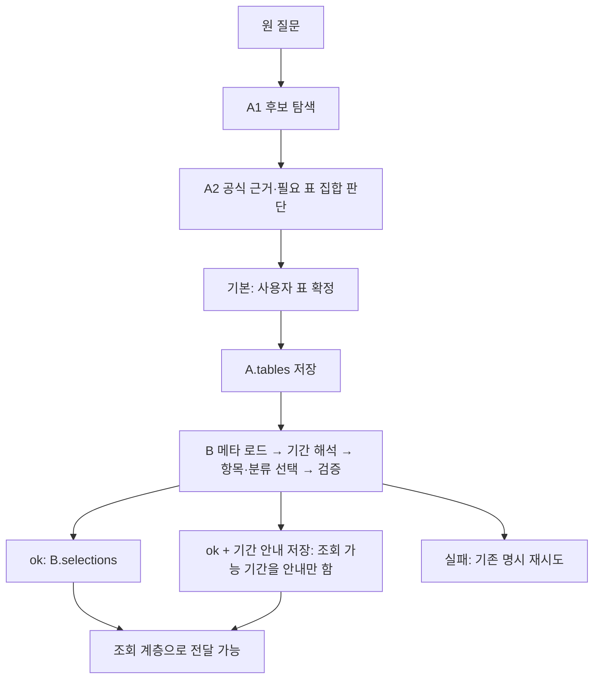

# A/B 파일 분리와 B ZIP 통합 검수

2026-10-06. 사용자가 지정한 `claview_B_검증_기간증강_20261002.zip`을 이번 B 기준으로 반영했습니다. 문서에 언급된 다른 판본으로 바꾸지 않았습니다. 현재 A1/A2와 기본 사용자 확정 경로를 유지합니다. 실제 모델·통계 API 호출은 0회입니다.

## 파일 담당과 적용 범위

| 담당 | 실행 파일 | 이번 변경 |
|---|---|---|
| A1/A2 | `a1_*.py`, `a2_*.py`, `a_discovery.py` | 기존 탐색·근거·표 집합 판단 유지. B 확인 안내를 연결 응답에 포함 |
| A 그래프 | a_graphs.py (당시 경로 `../../src/claview/a_graphs.py`, 현재 저장소 미포함) | 기존 `AState`, `build_a_graph`, `DiscoveryState`, `build_discovery_graph`를 이동. 기본 A1/A2를 묶는 사용자 선택 그래프와 이전 A 그래프를 구분 |
| 이전 A 모델 선택 | a_stages.py (당시 경로 `../../src/claview/a_stages.py`, 현재 저장소 미포함) | 현재 `ASteps`, A 프롬프트·질문 계획·검사·`select_tables`를 이동. ZIP의 이전 A로 교체하지 않음 |
| B 조회 조건 | [stages.py](../../../../modules/b/claview_b/stages.py) | ZIP의 `BSteps`, 상대기간·비교 기준기간·스키마·정규화·`select_series` 반영. A 이름은 기존 import 호환용 참조만 유지 |
| B 그래프·전체 연결 | [graphs.py](../../../../modules/b/claview_b/graphs.py) | ZIP의 `BState`, `build_b_graph` 반영. 현재 부모 파이프라인 유지. A 그래프 이름은 호환용 참조 |
| 공통 의존성 | [services.py](../../../../modules/b/claview_b/services.py) | `Services`, 입력 크기 검사 `bounded`를 한 곳으로 이동. A/B 검색기·모델·메타 저장소를 중복 구현하지 않음 |
| 공통 메타 | [metadata.py](../../../../modules/b/claview_b/metadata.py) | ZIP의 반기 H 지원 반영. A와 B가 모두 사용하는 공통 계층 |
| 실제 조회 계층 | [fetch.py](../../../../modules/b/claview_b/fetch.py) | ZIP의 주기 코드 변환·오류 기록 반영. 키를 반사하는 응답의 기록 차단만 추가 |
| 평가 | [evaluation.py](../../../../modules/b/claview_b/evaluation.py) | 현재 A 검색·후보 지표와 legacy 평가 경로 유지. ZIP의 `b_success` 계열을 추가 |
| 저장·복구 | candidate_store.py (당시 경로 `../../src/claview/candidate_store.py`, 현재 저장소 미포함) | B 결과(기간 안내 `period_notices`, status `needs_confirmation` 포함)를 저장·재사용. 2026-10-06 flow 변경으로 안내 후 조회 단계까지 진행함 |
| B 시험 | tests/b_part (당시 경로 `../../tests/b_part`, 현재 저장소 미포함) | ZIP의 시험을 전용 폴더에 수용. fixture 경로와 형식만 조정. 기존 전체 시험의 외부 연결 차단 유지 |
| B 기간 시험 자료 | eval/cases/b_period (당시 경로 `../../eval/cases/b_period`, 현재 저장소 미포함) | 증강13과 ZIP 스키마를 분리. 원본22는 수정하지 않음 |

`stages.py`·`graphs.py`에서 이전 A 이름을 import하는 코드도 그대로 동작합니다. 구현은 하나이며 복사본을 두고 관리하지 않습니다. B를 사용하려면 공통 `services`, `contracts`, `metadata`, `models` 등이 필요하므로 `stages.py`만 단독 전달하면 안 됩니다.

ZIP의 `cli.py`, `search.py`, `models.py`, `contracts.py`, `__init__.py`를 통째로 덮어쓰면 현재 A 기능·호출 예산·인증 경로가 사라질 수 있어 현재판을 유지했습니다. B 시험으로 호환성을 확인했습니다. 원본 ZIP의 모든 29파일은 incoming 보존본 (원본 저장소 보관 자료·공유본 제외)에 있습니다. 카탈로그 생성·기간 증강·실제 API 검증 스크립트 3개도 이 보존본에 남겼으며 실행하거나 현재 scripts에 덮어쓰지 않았습니다.

## 현재 연결



공통 A 출력은 기존 `org_id`, `table_id`, `table_name` 그대로입니다. 원 질문·확정 목록 보존 및 정상 B 연결은 모의 시험했습니다. 사용자 추가 답변이 있는 경로의 상세 계약은 [B 전달 인터페이스](../design/A에서_B로_전달하는_인터페이스.md)를 따릅니다.

(2026-10-06 flow 변경으로 대체됨. 종전에는 B가 기간 확인 대기에서 멈췄으나, 현재는 조회 가능 기간을 안내(`response.notices`, `b_result.period_notices`)로 저장하고 조회 단계까지 진행함. 이용자에게 진행 여부를 묻지 않으므로 확인 답변을 받아 B를 재개하는 기능은 필요하지 않음. 상세는 [B 10-06 정정 반영 내역](B_10-06_정정_반영_내역_2026-10-06.md) 6절 참고.)

## B의 기능별 분리에 대한 판단

**현재 분리는 대체로 적절합니다.** 메타 정규화 → 조건 결정 → 조회 요청·응답 검증 → 실행 그래프 → 평가의 책임이 다릅니다. 함수 실행과 B 그래프가 같은 `BSteps`를 사용하는 점도 중복 구현을 피합니다. 이번에는 A/B가 섞인 구현만 분리했고, B의 기간 함수나 조회 조건 로직을 새 하위 모듈로 재설계하지 않았습니다.

다만 다음은 후속 검토 대상입니다.

1. `stages.py`에는 기간 계산, 프롬프트 문맥, 선택 검증, 실행 노드가 함께 있습니다. 기간 정책의 수정 빈도가 높아지면 순수 기간 함수만 별도 모듈로 분리할 수 있습니다. 지금 파일을 더 나누는 것이 동작 정확도를 보장하지는 않습니다.
2. `graphs.py`는 B 전용 파일이 아니라 B 그래프와 A→B→조회 부모 연결을 함께 담습니다. B 노드 내부와 부모의 확인·재시도 책임을 구분해야 합니다.
3. (대체됨, 2026-10-06) 기간 `needs_confirmation`은 안내 저장 후 조회로 진행하도록 변경했습니다. 동의·거절·기간 변경을 받는 재개 계약은 현재 범위에 없습니다.
4. `b_success`는 기간만 정답과 맞는 확인 대기도 포함합니다. 항목·분류·단위 선택 완료나 실제 사용자 확인 성공 지표로 사용하면 안 됩니다.
5. (정정, 2026-10-06 오후: 이 항목의 분기 달력 규칙과 요청 Y/H→A/S 변환은 10-02 판본의 동작이었고, 10-06 최종 B 기준으로 폐지·정정함. [B_10-06_정정_반영_내역](B_10-06_정정_반영_내역_2026-10-06.md) 참고.) ZIP의 분기 ‘최근 N년’ 달력 시작 규칙, ‘올해/작년’의 표 최신 연도 기준, 요청 Y/H→A/S 변환은 당시 판본의 동작으로 보존했습니다. 일반 의미 정확도와 실제 API 요청 적합성을 이번 오프라인 시험으로 확정할 수 없습니다. 특히 분기 규칙은 ZIP 설명상 기존 정답 대조에 맞춰 결정한 정책이므로 독립 검수 자료로 확인해야 합니다. 이번 작업에서 새 정답 규칙을 추가하지 않았습니다.
6. 공통 `Config.period_policy`의 기존 값은 `explicit_only`이나 ZIP의 B는 상대기간 해석을 수행합니다. 현재 이 문자열만으로 B 정책을 설명할 수 없으며, 이번 판본과 실제 B 실행 결과를 함께 기록해야 합니다. 정책 명칭·선택 옵션 정비는 별도 변경으로 남겼습니다.

## 검증 결과와 의미

| 확인 | 결과 | 해석 |
|---|---|---|
| 전체 오프라인 시험 | **516 통과, 2 skip** | 두 skip은 ZIP 시험의 빈 매개변수 목록. 실제 API 미호출 |
| 정적 검사 | `ruff check src tests` 통과 | 분리 후 import·정의 확인 |
| A 구현 보존 | 이동한 A 함수·클래스·상수의 AST 동일 | 기존 A1/A2 주요 파일·모델·검색 파일도 해시 동일 |
| B 구현 보존 | ZIP의 B 함수·클래스·상수, B 그래프·메타 정의의 AST 동일 | imports·파일 위치·형식 변화와 최소 연결 수정 구분 |
| A 기존22 검색 | 후보 포함22/22, Top5 22/22, Top1 11/22, MRR 0.7151515 | 기존 22건 모두 정답 순위 동일. 최종 자동 선택 정확도가 아님 |
| A 후보 총수 | 246 → 245 | CV-AB-12의 반기 전용 DT_105Y001이 분기 질문에서 제외. 반기 메타 인식 효과, 정답 누락 없음 |
| B 기존22 모의 재생 | (10-06 flow 변경 전) 조건 정확 일치 `ok` 14건, 기간 해석 후 확인 대기 8건. 변경 후에는 22건 모두 `ok`이며 8건에 기간 안내 첨부 | 정답 A·모의 B 응답을 공급한 결정론적 검사. 실제 모델 정확도 아님 |
| B ZIP식 `b_success` | 22/22 | 위 14건+기간만 맞는 대기8건. 전체 조회 성공으로 보고하지 않음 |
| 연결·복구 | 정상 인계, 기간 안내 저장, 재시작, 중복 실행 방지 통과 | 원문·A.tables 유지, 재시작 시 저장된 B 결과·안내 재사용(모델 재호출 없음) |
| 키 비노출 | 임시 키를 반사한 모의 오류/정상 응답 기록 차단 | 실제 키 읽기·인증 확인 없음 |

기존22는 모두 단일 표입니다. 추가48과 이번 ZIP의 기간 증강13은 이 22건 성능 지표에 합산하지 않았습니다. 기간 증강13은 코드 정책에 따른 기능 시험 자료이며 새로운 검수 골든셋으로 승인하지 않았습니다. A 실행 시간은 전체 회귀 시험과 병행 측정했으므로 성능 전후 비교 근거로 사용하지 않습니다.

원본22와 카탈로그는 작업 전 해시를 유지했습니다. 원시 메타는 ZIP과 기존 자료가 동일함을 확인하고 덮어쓰지 않았습니다. ZIP 카탈로그는 현재판과 달라 보존본에만 남겼습니다.

구현·모의 검증은 완료했습니다. **실제 B 모델 선택, 통계 API 조회, 확인 답변 후 재개, 다중 표 B 확인의 완결성은 미확인**입니다.

## 근거 기록

- ZIP 출처·원본 29파일·변경 전 해시 (원본 저장소 보관 자료·공유본 제외)
- A/B 구현 보존 및 A 검색 비교 (원본 저장소 보관 자료·공유본 제외)
- A22 검색 실행 (원본 저장소 보관 자료·공유본 제외)
- B22 모의 재생 (원본 저장소 보관 자료·공유본 제외)
- 최종 전체 시험 XML (원본 저장소 보관 자료·공유본 제외)
- 경계·복구·키 비노출 시험 (당시 경로 `../../tests/test_ab_separation.py`, 현재 저장소 미포함)

`runs` 기록은 로컬 재현 근거이며 Git에 자동 포함되지 않습니다. 팀에 결과까지 전달할 때 위 JSON·XML을 선별해서 함께 전달합니다. 원본 보존본과 변경 전 사본 전체를 팀 실행 파일로 전달할 필요는 없습니다.

## 직접 실행

저장소 루트의 PowerShell에서 실행합니다. 아래는 전부 외부 호출 없는 검사입니다.

```powershell
uv run --env-file .env --locked python -m pytest -q tests/b_part tests/test_ab_separation.py
uv run --env-file .env --locked python -m pytest -q
uv run --env-file .env --locked ruff check src tests

$checkDir = "runs/ab-review-$(Get-Date -Format 'yyyyMMdd-HHmmss')"
New-Item -ItemType Directory -Path $checkDir | Out-Null
uv run --env-file .env --locked claview evaluate-search --cases eval/cases/golden_set_v1.json --db "$checkDir/candidates.sqlite3" --as-of 2026-10-02 --retrieval-policy baseline --document-profile legacy --mapping-policy approved --a-agent-mode off --output "$checkDir/evaluation.json"
```

다음 실제 연결 검증은 명시 기간 사례부터 B 모델 선택·조회 값을 확인하고, 상대기간 확인 후 재개는 별도 계약을 정한 뒤 진행하는 것이 적절합니다. 이번에 A 순위·자동 채택 정책을 개선하거나 실제 호출까지 진행하지 않았습니다.
