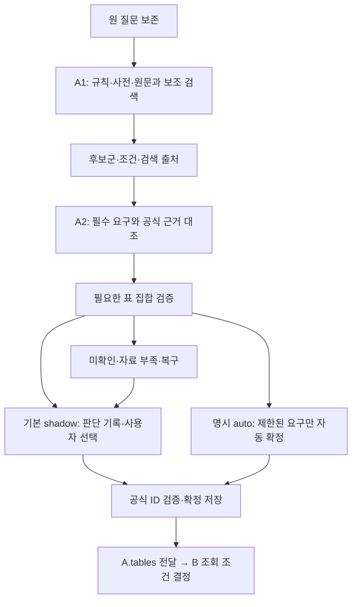

> 이전 A(10-06, A1/A2) 문서다. 현재 A는 N5이며 설명은 claview-A-1015의 docs를 본다.

# A 현재 아키텍처

2026-10-06 기준. 기본 진입점은 `claview search-tables` → `discovery_cli.main` → `TableDiscovery`입니다.

## 구현 위치

| 책임 | 코드 |
|---|---|
| 원문 근거·조건·별도 답변 | a1_query.py (당시 경로 `../../src/claview/a1_query.py`, 현재 저장소 미포함) |
| A1 서브그래프·원문 후보 보호 | a1_graph.py (당시 경로 `../../src/claview/a1_graph.py`, 현재 저장소 미포함) |
| 사전·조건부 확장 | [mappings.py](../../../modules/b/claview_b/mappings.py), a1_mappings.py (당시 경로 `../../src/claview/a1_mappings.py`, 현재 저장소 미포함) |
| 문서·검색 결합 | [search_documents.py](../../../modules/b/claview_b/search_documents.py), [document_corpus.py](../../../modules/b/claview_b/document_corpus.py), [search.py](../../../modules/b/claview_b/search.py), a_retrieval.py (당시 경로 `../../src/claview/a_retrieval.py`, 현재 저장소 미포함) |
| 적합성·공식 근거 | a_conditions.py (당시 경로 `../../src/claview/a_conditions.py`, 현재 저장소 미포함), a_semantics.py (당시 경로 `../../src/claview/a_semantics.py`, 현재 저장소 미포함), a2_evidence.py (당시 경로 `../../src/claview/a2_evidence.py`, 현재 저장소 미포함) |
| A2·표 집합·답변 | a2_graph.py (당시 경로 `../../src/claview/a2_graph.py`, 현재 저장소 미포함), a2_selection.py (당시 경로 `../../src/claview/a2_selection.py`, 현재 저장소 미포함), a2_interaction.py (당시 경로 `../../src/claview/a2_interaction.py`, 현재 저장소 미포함) |
| 순위·확정·B 연결 | a_discovery.py (당시 경로 `../../src/claview/a_discovery.py`, 현재 저장소 미포함) |
| SQLite·원자적 확정·복구 | candidate_store.py (당시 경로 `../../src/claview/candidate_store.py`, 현재 저장소 미포함) |
| A 그래프·기존 A 모델 선택 | a_graphs.py (당시 경로 `../../src/claview/a_graphs.py`, 현재 저장소 미포함), a_stages.py (당시 경로 `../../src/claview/a_stages.py`, 현재 저장소 미포함) |
| B·부모 그래프·공통 의존성 | [stages.py](../../../modules/b/claview_b/stages.py), [graphs.py](../../../modules/b/claview_b/graphs.py), [services.py](../../../modules/b/claview_b/services.py) |

두 서브그래프는 기존 검색기와 저장소를 공유합니다. 원문은 불변이며 조건·검색 표현·답변을 별도로 관리합니다. 조건에는 원문 위치·대상·명시/추론/미확정 상태를 기록합니다. 구조화 단계에서 표 수를 먼저 정하지 않습니다.

지정 B ZIP의 기능을 반영하고 A 전용 구현을 분리했습니다. 기본 A1/A2·선택 정책은 유지하며, B의 기간 안내(조회 가능 기간)는 안내만 하고 조회 단계로 진행하며, 저장·재시작 후에도 보존합니다. 파일별 범위·시험 결과는 [A/B 통합 검수](../../modules/b/research/A_B_분리와_B_통합_검수_2026-10-06.md)를 참고합니다.

A2는 요구×후보의 충족·충돌·미확인, 공식 인용·자료 판본, A 미확정과 B 조회 조건을 구분합니다. 다른 항목 경로의 단어를 합쳐 하나의 계열로 확정하지 않습니다. 근거가 없으면 충족으로 처리하지 않습니다.

## 기본 정책과 한계

기본 `rules/evidence/shadow`, `baseline/legacy`, `mapping=approved`, `agent=off`입니다. A2 근거 대조는 현재 표시 순위를 직접 바꾸지 않습니다.

auto는 공식 명칭을 명시하는 제한된 문법에서 전체 요구 충족·추가 표의 필요성·충돌·미확정을 검사한 뒤 기존 confirm 경로를 사용합니다. Top1·점수 차이를 정답 확률로 취급하지 않습니다. 한 표의 여러 계열, 중복·대안 표를 구분합니다.

기존22에서는 `whole_question_meaning_not_verified`로 자동0건입니다. 이는 질문이 반드시 모호하다는 뜻이 아니라 현재 구현의 의미 확인 한계를 포함합니다. 표시5개는 페이지 크기이며 표 집합 크기가 아닙니다.

## 모델·호환 경로

a1_interpreter.py (당시 경로 `../../src/claview/a1_interpreter.py`, 현재 저장소 미포함)는 명시적으로 주입하는 해석 실험 경로입니다. run_a1_stage5.py (당시 경로 `../../scripts/run_a1_stage5.py`, 현재 저장소 미포함)가 provider·예산 장부·근거 검증을 재사용합니다. 기본은 off이며 잘못된 해석은 원문 검색으로 복귀합니다. HCX-007 실제 응답7건의 원문 위치 검증 통과는0건입니다.

AAgent·모델 계약·provider·runtime·실험 장부는 유지합니다. EvidenceJudge 실제 효과·벡터/리랭커 품질은 미확인입니다. 기존 evaluate-a/legacy 자동 선택은 별도 경로입니다.

평가 계약·predict/score는 검색 문서 시험과 호출 계획 검증에서도 사용하므로 유지합니다. 과거 raw-cards 전용 a_raw/a_evidence와 단계별 일회성 도구만 보관 후 제거했습니다. 현재 a2_evidence는 유지했습니다.

[22건 평가](A1_A2_22건_통합평가_6단계_2026-10-06.md)의 후보 포함·Top5는22/22, Top1은11/22입니다. 사용자 최종 확정·B 실제 의미·수치 검증은 미확인입니다. 임의 추가48은 테스트 전용입니다.

실행·복구 (당시 경로 `../guides/A_사용자선택_실행과_복구.md`, 현재 저장소 미포함) · [B 전달 계약](../../modules/b/design/A에서_B로_전달하는_인터페이스.md)
